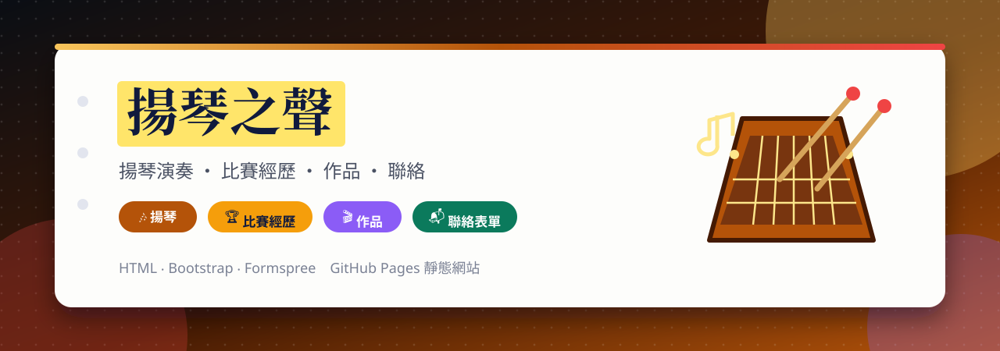
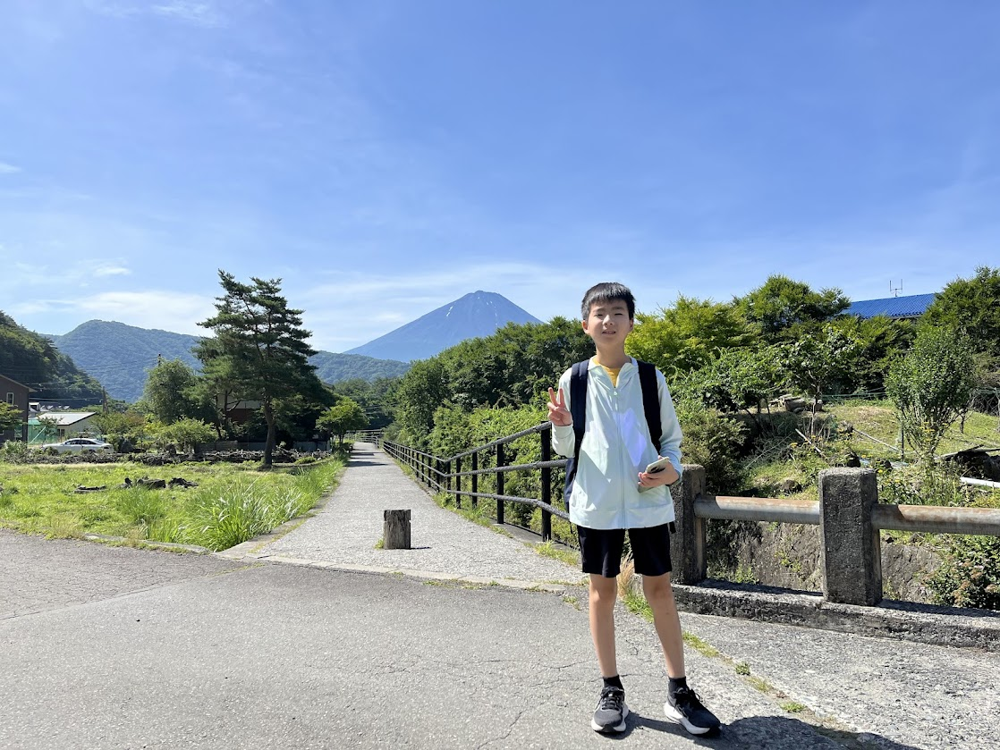
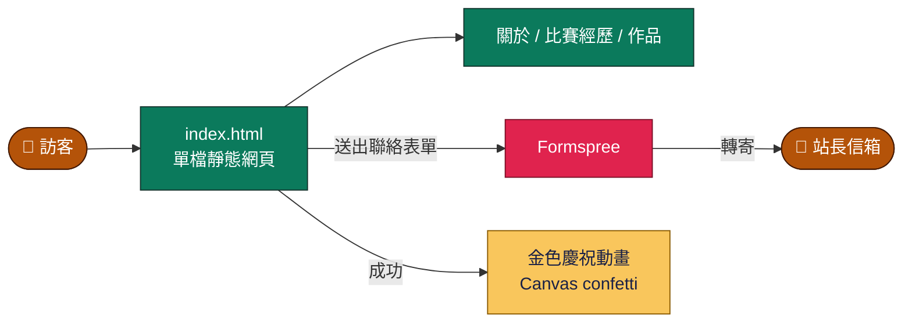

<a id="top"></a>

<div align="center">



<br>

[](https://github.com/Jiachang1112/Eddie)
[](https://github.com/Jiachang1112)
[](https://jiachang1112.github.io/Eddie/)

[](https://developer.mozilla.org/docs/Web/HTML)
[](https://developer.mozilla.org/docs/Web/CSS)
[](https://developer.mozilla.org/docs/Web/JavaScript)
[](https://getbootstrap.com/)
[](https://formspree.io/)
[](https://pages.github.com/)

**揚琴演奏者的個人網站 ‧ 關於 ‧ 比賽經歷 ‧ 作品 ‧ 聯絡表單 ‧ 金色慶祝特效**

<br>

[](#-網站內容)
[](#-快速開始)
[](#-設定聯絡表單)
[](#-發佈到-github-pages)
[](#-常見問題)

</div>

---

## 🎶 網站內容

<div align="center">



</div>

<table>
<tr>
<td width="33%" valign="top">

### 🏠 首頁
深色背景搭配金色重點色，主視覺與一句話介紹，並提供「查看比賽經歷」與「聯絡我」兩個按鈕。

</td>
<td width="33%" valign="top">

### 👤 關於
介紹專長與興趣，以及指導老師、伴奏老師等合作夥伴。

</td>
<td width="33%" valign="top">

### 🏆 比賽經歷
依時間排列的比賽紀錄卡片，標示名次、組別與日期。

</td>
</tr>
<tr>
<td width="33%" valign="top">

### 🖼️ 作品
作品與演出相片的展示區。

</td>
<td width="33%" valign="top">

### 📬 聯絡
用 Formspree 收信的聯絡表單，送出後會出現金色慶祝動畫。

</td>
<td width="33%" valign="top">

### 🔎 SEO
加入 Schema.org 的 Person 結構化資料，讓搜尋引擎更容易了解這個人與專長。

</td>
</tr>
</table>

---

## 🧩 運作方式



- 整個網站是**一個 `index.html`**，樣式與腳本都在裡面，Bootstrap 從 CDN 載入。
- 主要顏色定義在檔案開頭的 CSS 變數（背景、文字、金色重點色），想換配色改這裡即可。

### 📁 檔案說明

```text
Eddie/
├── index.html      整個網站（HTML + CSS + JS）
└── assets/
    └── 主圖.png     首頁主視覺
```

---

## ⚡ 快速開始

```bash
git clone https://github.com/Jiachang1112/Eddie.git
cd Eddie
python3 -m http.server 8000      # 打開 http://localhost:8000/
```

**改成你自己的內容：** 直接編輯 `index.html` 裡「關於」「比賽經歷」「作品」區塊的文字，並更新檔案開頭 `<script type="application/ld+json">` 裡的結構化資料。

---

## 📬 設定聯絡表單

聯絡表單使用 [Formspree](https://formspree.io/)：

1. 註冊 Formspree 並建立一個表單，取得 `https://formspree.io/f/xxxxxxxx` 網址。
2. 把 `index.html` 裡 `<form id="contactForm" action="…">` 的 `action` 換成你自己的網址。
3. 第一次送出時，Formspree 會寄確認信到你的信箱，確認後才會開始轉寄。

---

## 🚀 發佈到 GitHub Pages

Settings → Pages → Source 選 `main` 分支的 `/ (root)`，約 1～2 分鐘後上線：[jiachang1112.github.io/Eddie](https://jiachang1112.github.io/Eddie/)。

---

## ❓ 常見問題

<details>
<summary><b>表單送出後沒收到信</b></summary>

先檢查 Formspree 後台是否已確認信箱，並看垃圾郵件匣。

</details>

<details>
<summary><b>相簿圖片是隨機圖片</b></summary>

目前作品區使用示意圖片，請換成你自己的照片並放進 `assets/`。

</details>

<details>
<summary><b>想換掉主視覺</b></summary>

替換 `assets/主圖.png`，或修改 `index.html` 裡對應的圖片路徑。

</details>

---

<div align="center">

[GitHub @Jiachang1112](https://github.com/Jiachang1112)　‧　[Eddie](https://github.com/Jiachang1112/Eddie)

[](#top)

</div>
